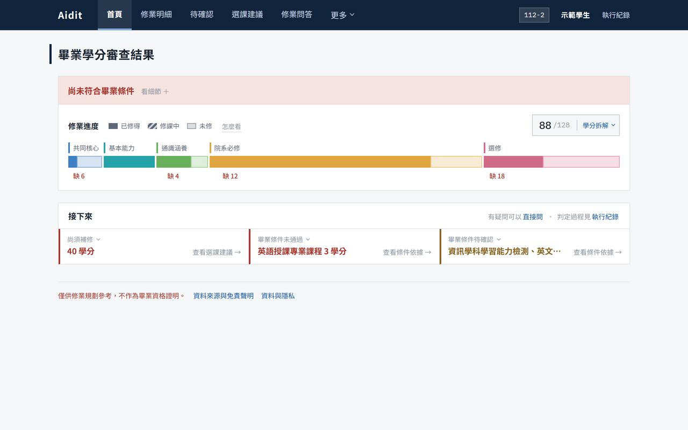
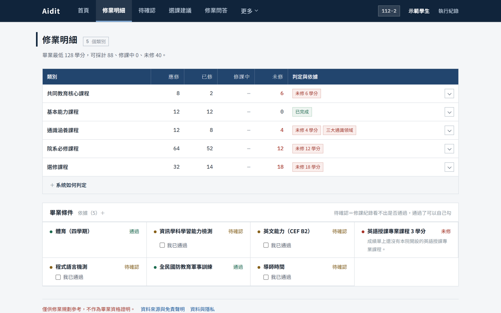
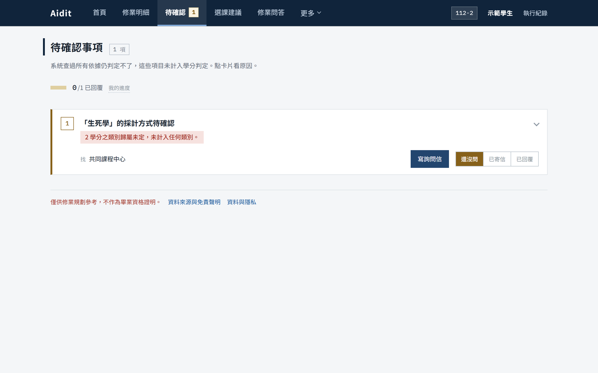
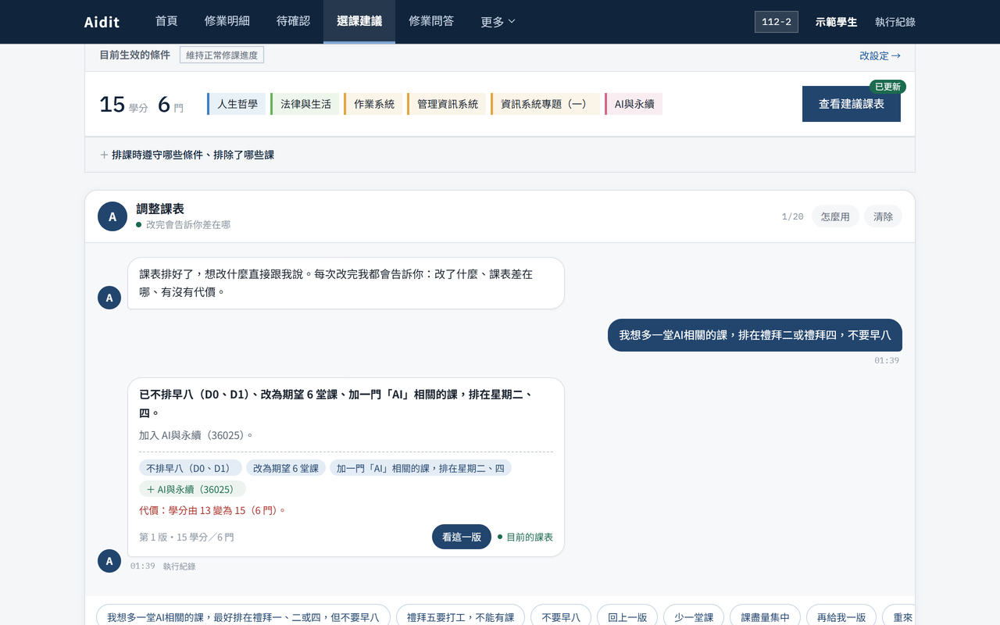
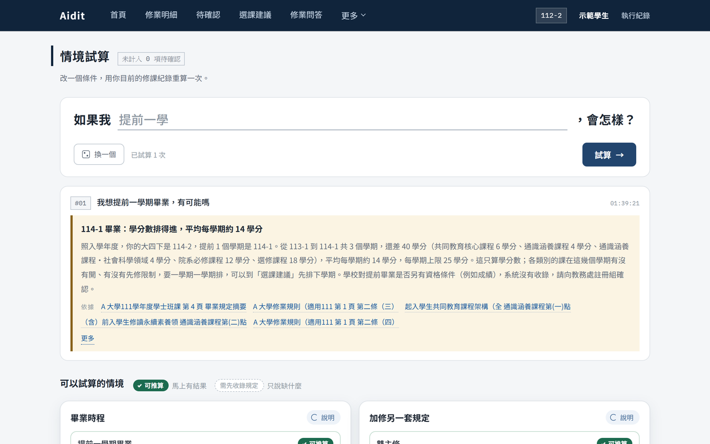
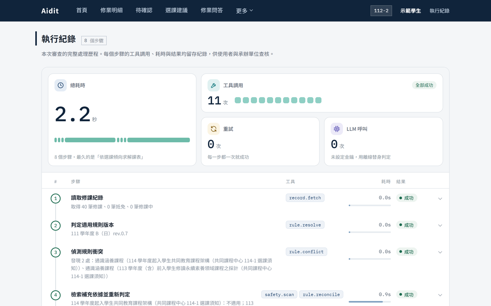

<div align="center">


# Aidit

**會查證、會說「不知道」的修業規劃 Agent**

畢業審查 · 選課建議 · 情境試算 · 修業問答

[](LICENSE)


[線上展示](https://aidit-weld.vercel.app) · [快速開始](#快速開始) · [架構](#架構) · [評測](#評測)



</div>

> **在畢業審查場域，答錯的代價遠高於不答。**
> 學分由確定性引擎計算，模型只負責理解；規定沒寫清楚的地方不硬算，改成待確認事項，告訴你該問誰。

## 功能

<table>
  <tr>
    <td width="50%"><br><b>修業明細</b>：逐類別比對學分，每一列可展開看採計了哪些課與引用原文</td>
    <td width="50%"><br><b>待確認事項</b>：規定沒寫清楚就停下來，說明影響幾學分、該找哪個單位，一鍵寫詢問信</td>
  </tr>
  <tr>
    <td><br><b>選課建議</b>：依未修學分與開課資料排出下學期課表，用一句話微調，回報改了什麼與代價</td>
    <td><br><b>情境試算</b>：提前畢業、停修、雙主修、輔系、學程，依規定逐項推算</td>
  </tr>
  <tr>
    <td colspan="2"><br><b>執行紀錄</b>：每一步的工具、耗時、重試與分支，可匯出查核</td>
  </tr>
</table>

## 快速開始

```bash
npm install
npm run dev          # http://localhost:3000
```

**不需要任何金鑰。** 沒有設定模型與資料庫時，意圖解析與公告判斷改用確定性替身（trace 標示 `mode=offline`），
展示、評測與 CI 都能完整執行。要接真實服務時複製 `.env.example` 為 `.env`。

| 指令 | 用途 |
|---|---|
| `npm run test` | 單元測試 |
| `npm run ci` | 7 項 CI 檢查 |
| `npm run eval` | 審查評測（35 個 golden 案例＋固定流程基準） |
| `npm run eval:injection` | 提示注入攔截率／誤攔率 |
| `npm run eval:understanding` | 對話理解跑分（加 `-- --live` 接模型） |
| `npm run eval:baseline-c` | 本系統 vs. 單次 LLM（加 `-- --live` 接模型） |

### 部署

| 元件 | 說明 |
|---|---|
| 網站 | Vercel（Next.js），環境變數照 `.env.example` |
| 資料庫 | Supabase，依序執行 `supabase/migrations/` |
| 模型 | 預設 Claude Haiku 5.5；也可指向任何 OpenAI 相容端點（例如校內自架的 Ollama），設 `AIDIT_LLM_PROVIDER`、`AIDIT_LLM_BASE_URL` |
| 校對頁密碼 | `npx tsx scripts/set-review-password.ts` |

## 怎麼保證不亂算

| | 做法 |
|---|---|
| **算數的那層沒有模型** | 學分審查、排課求解、原文回查是純確定性運算；CI 從這三個模組做遞移相依分析，任一層 import 到 LLM client 就失敗 |
| **不變式失敗就中止** | 各類學分加總對不上就不輸出結果；超修不得填補其他類別 |
| **結論都能回查原文** | 規則包每個欄位都帶原文引句，輸出前逐條比對；對不上重試一次，仍失敗該條降級為待確認 |
| **對話裡的字不是模型寫的** | 模型只輸出意圖與參數，schema 結構上沒有回答欄位；回覆由模板組成，學分數字一律等於引擎算的數字 |
| **規則的洞寫在資料裡** | 規則包用 `ambiguities` 記錄沒寫清楚的地方，命中的修課移出判定、產生待確認事項 |
| **外部內容是資料，不是指令** | 公告與使用者訊息都先過注入檢查，命中就不送模型 |

## 架構

```
src/
  app/            頁面與 API（audit、plan、chat、whatif、trace、review、corpus…）
  components/     依功能分：shell、audit、plan、chat、sources、settings、trace
  lib/
    agent/        step runner＋狀態機；steps/ 每步一個檔，tools/ 工具實作
    audit/        學分歸屬（指派問題）與確定性審查
    solver/       時段解析與選課組合求解（分支定界）
    verify/       引用回查
    safety/       注入檢查
    chat/         對話：意圖解析、條件套用、能力、回覆組成
    whatif/       情境試算
    rules/        規則包、公告庫、原文語料
    offerings/    開課資料
    llm/          唯一的模型呼叫入口
    store/        trace 與偏好儲存（Supabase／本地檔案）
  eval/           golden set、注入、對話理解、單次 LLM 基準
scripts/          CI、規則包抽取與驗證、開課資料抓取與上傳
supabase/         資料庫 migration
tests/            單元測試
```

沒有引入 agent 框架：流程有限且已知，一個 step runner 就夠，trace 格式也要自己控制。

<details>
<summary><b>Agent 流程（含分支與重試）</b></summary>

```
fetchRecord ──fail──────────────────────────> ERROR（不輸出部分結果）
     │ok
resolveRuleVersion ──學籍與入學學年不符──> ALL_HOLD（整案轉人工）
     │ok
detectConflicts → reconcileConflicts（公告是否適用：先注入檢查，再問模型）
     ├─resolved───> auditCredits
     └─unresolved─> 待確認 ─> auditCredits（該項不計入）
                          │ 不變式失敗 ──> ERROR
                    verifyCitations ──fail×2──> 該條降級為待確認
                          │ok
                    searchOfferings ──empty──> DONE（僅出審查結果）
                          │
                    solveSchedule ──無解──> 找出衝突條件、放寬後重試 ──> DONE
```

</details>

<details>
<summary><b>規則包：從 PDF 到鎖版</b></summary>

```bash
python scripts/pdf-to-segments.py plan.pdf <docId> "<文件標題>" > segments.json   # PDF → 分段（保留頁碼）
npm run rulepack:extract -- --segments segments.json --id <id> ...              # 模型抽取草稿，每欄附原文引句
npm run rulepack:validate                                                        # 自動驗證，不通過不進校對
npx tsx scripts/push-draft.ts ...                                                # 上傳草稿 → /review 人工逐條校對 → 鎖版
```

開課資料：`scripts/fju-sis-fetch.py` 抓學校公開課程查詢、`fju-sis-offerings.py` 轉換、`push-offerings.ts` 上傳後即生效，不用重新部署。

</details>

## 評測

| 項目 | 結果 |
|---|---|
| 審查 golden set（35 案） | 正確率 100%、**錯答 0**；固定流程 2 案少報未修學分 |
| 真實成績單 10 個時間點：本系統 vs. 同一模型直接算 | 本系統 **10/10**、平均 1.3 秒、不呼叫模型；單次 LLM 20 次答對 9、轉人工 10，同題兩次一致 3/10 |
| 對話理解（78 句） | 只有規則 69/78；接模型 **78/78** |
| 模型故障（連不上、逾時） | 自動退回規則，審查仍零錯答 |
| 提示注入 | 惡意 16 則攔截 100%、正常 9 則誤攔 0% |
| 對話 100 輪（正式站） | 失敗 0，P50 2.75 秒、P95 5.90 秒，每輪約 US$0.0005 |

## 安全與治理

- 不代為選課、不寫回任何校務系統、不儲存帳密
- 不預測成績或是否被當、不評價教師
- 修課紀錄只在單次請求中處理；trace 只存去識別內容（學號經 HMAC），保留 90 天
- 畢業資格一律標示為參考，非證明

## 已知限制

- 真實規則目前以一個學系、一個入學年度為主；雙主修、輔系、學程只收錄部分，沒收錄的會明講，不推算
- 提前畢業在目標學期前還有多個學期時，只估算學分數是否排得進，不逐學期排課
- 開課資料只有學校公開介面提供的欄位

## 授權

[MIT](LICENSE)
